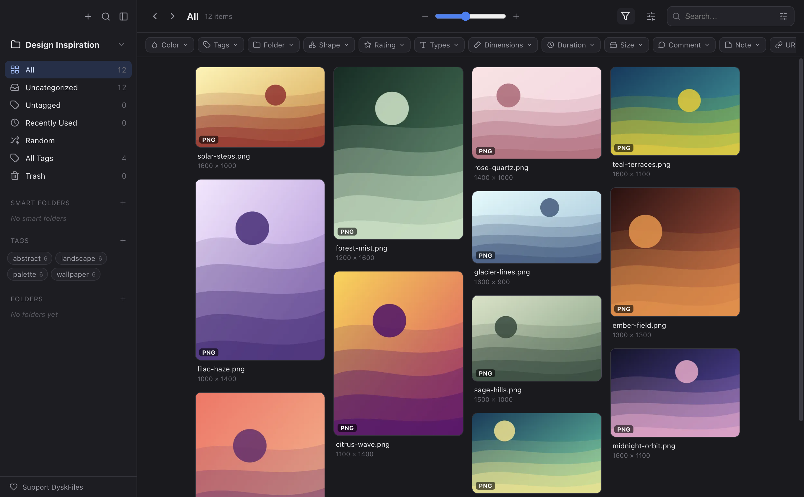
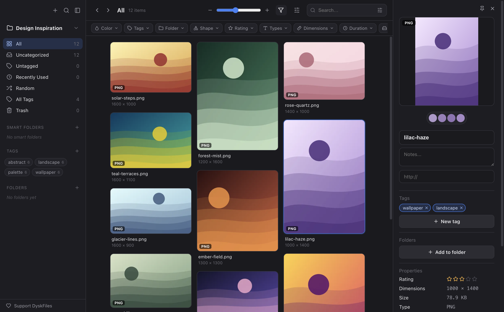
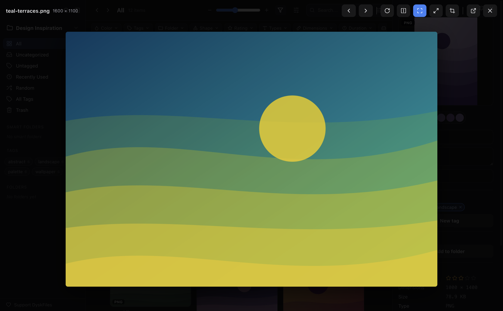
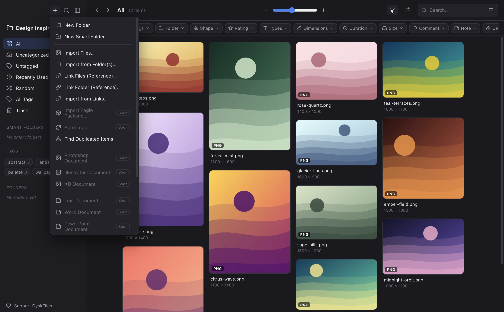

<p align="center">
  
</p>

<h1 align="center">DyskFiles</h1>

<p align="center">A desktop asset manager that keeps your library in tidy, readable folders: thumbnails and JSON, no database.</p>

<p align="center">
  <a href="https://github.com/DyskLab/dyskfiles/releases/latest"></a>
  <a href="LICENSE"></a>
  <a href="https://www.fanny.dev/dysklab"></a>
  <a href="https://buymeacoffee.com/fannydevz"></a>
</p>



Create a library, drag in your images, videos, audio, and text files, then browse and organize them. Unlike Eagle,
which stores items in randomly named `xxxx.info/` folders, DyskFiles keeps everything in flat folders you can read in
Finder, grouped by the first three letters of each file name.

## Download

Get the DMG for Apple Silicon from the [latest release](https://github.com/DyskLab/dyskfiles/releases/latest), open it,
and drag **DyskFiles** into Applications.

The app isn't notarized, so macOS blocks the first launch. Open **System Settings > Privacy & Security** and choose
**Open Anyway**, or run:

```bash
xattr -dr com.apple.quarantine /Applications/DyskFiles.app
```

On Intel Macs, [run it from source](#run-from-source).

## Features

**Libraries**
- Keep several `<name>.dyskfiles` libraries and switch between them from the sidebar. The last one reopens on launch.
- Change a library's icon, reveal it in Finder, merge it into another library, remove it, or delete it.
- Libraries made before the rename (`<name>.pitek`) open as they are.

**Importing**
- Drag and drop, a file picker, a whole folder, or a URL.
- **Linked imports** reference files where they are, so the library holds only metadata and a thumbnail.

**Media**
- **Images:** WebP thumbnails up to 400px, made with [sharp](https://sharp.pixelplumbing.com/).
- **Video and audio:** built-in players, with a poster frame captured automatically for video.
- **Text and code:** a CodeMirror editor with syntax highlighting.

**Organizing**
- Multiple folders per item, tags with an All Tags page, and smart folders that save a filter.
- Views for All, Uncategorized, Untagged, Recently Used, Random, and Trash.
- Filters for type, color, shape, rating, dimensions, duration, size, dates, comment, note, and URL.
- Search with a configurable scope, and duplicate detection by content hash.

**Viewing and editing**
- Waterfall, justified, grid, and list layouts, with zoom and sorting.
- An inspector with rating, tags, folders, notes, URL, color palette, and metadata.
- A preview with rotate, flip, fit or actual size, crop, and next and previous.

| Inspector | Preview | Add menu |
| --- | --- | --- |
|  |  |  |

## Library layout on disk

Each item's metadata, original, and thumbnail sit together in a folder named after the first three letters of the file
name:

```
MyLibrary.dyskfiles/
├── library.json             # name, version, createdAt, itemCount
├── tags.json                # tag list
├── filters.json             # smart folders
├── folders.json             # folders
├── pre/                     # files whose names start with "pre"
│   ├── preview-l9x2ka.json  # one metadata file per item
│   ├── preview-l9x2ka.png   # the original (left out for linked imports)
│   └── preview-l9x2ka.webp  # the thumbnail
└── mov/
    ├── movie-k1p8.json
    ├── movie-k1p8.mov
    └── movie-k1p8.webp
```

Libraries in the older `items/`, `originals/`, and `thumbnails/` layout are migrated the first time they're opened.

## Run from source

You need Node.js.

```bash
git clone https://github.com/DyskLab/dyskfiles.git
cd dyskfiles
npm install
npm run dev
```

| Command | What it does |
| --- | --- |
| `npm run build` | Bundles the app into `out/` |
| `npm run check` | Runs `svelte-check` |
| `npm run dist` | Builds the Apple Silicon DMG into `dist/` |

## Project structure

- **`src/main/`** owns all file access: libraries and storage (`library.ts`), thumbnails (`thumbnail.ts`), saved
  settings (`config.ts`), and the window, IPC handlers, and `asset://` protocol (`index.ts`).
- **`src/preload/`** exposes a small typed `window.rak` API through `contextBridge`.
- **`src/renderer/`** is the Svelte 5 and TypeScript interface.

## Support

DyskFiles is free and open source. If it helps you, you can
[buy me a coffee](https://buymeacoffee.com/fannydevz).

## Part of DyskLab

DyskFiles is part of [DyskLab](https://www.fanny.dev/dysklab), alongside
[DyskFlow](https://github.com/DyskLab/dyskflow), [DyskFocus](https://github.com/DyskLab/dyskfocus), and DyskLink for
[Mac](https://github.com/DyskLab/dysklink-mac) and [Android](https://github.com/DyskLab/dysklink-android).

## License

[MIT](LICENSE)
